# 实验四：软件架构与 UML

## 状态

✅ 已完成

## 实验目的

分析 Teedy 的模块结构与 Java 包结构，为各包生成 UML 图，分析主要类及类之间的关系，并解释主要模块及其交互过程。

## 实验原理

- **UML（统一建模语言）**：用于可视化软件设计的标准建模语言，常用图包括：
  - **包图/组件图**：展示模块间依赖关系。
  - **分层架构图**：展示系统的逻辑分层（表现层/业务层/数据层）。
  - **类图**：展示类、接口及其关联、继承、依赖关系。
  - **时序图**：展示对象间按时间顺序的交互（如一次文档上传的完整调用链）。
- **PlantUML**：用纯文本 DSL 描述 UML 图，由 `plantuml.jar` 渲染为 PNG。

## 实验任务

1. 分析 Teedy 的模块结构及 Java 包结构。 ✅
2. 为各包生成 UML 图。 ✅
3. 分析主要类及类之间的关系。 ✅
4. 解释主要模块及其交互过程。 ✅

## 分步操作过程

### 1. 分析模块与包结构

梳理 Teedy 的 Maven 多模块结构：

- **docs-parent**（父 POM，统一依赖与插件版本）
  - **docs-core**：后端核心（实体、DAO、业务逻辑）
  - **docs-web-common**：Web 公共层
  - **docs-web**：REST 资源层 + Web 入口

**架构设计特点**（详见 `reports/architecture-analysis.md`）：
- 实体用**字符串外键**（如 `userId`、`fileId`）而非 JPA `@ManyToOne`，由 DAO 手动 join。
- DAO 通过 `ThreadLocalContext.get().getEntityManager()` 获取 EntityManager（线程本地上下文模式）。
- REST 资源类均继承 `BaseResource`（鉴权基类）。

### 2. 安装 PlantUML 工具

从 Maven Central 下载 `plantuml-1.2024.7.jar`（21MB）到 `D:\tools\plantuml.jar`（GitHub Release 源国内极慢，改用 Maven Central 约 1 分钟）。

### 3. 编写 .puml 源文件并渲染

```bash
java -jar plantuml.jar -charset UTF-8 -tpng -o <输出目录> <输入.puml>
```

**中文字体关键配置**（必须写进 .puml 文件，命令行参数无效）：

```plantuml
@startuml
!theme plain
skinparam defaultFontName "SimHei"   # 必须在 !theme plain 之后，否则被主题重置
...
@enduml
```



### 4. 绘制 4 张 UML 图

| 图 | 说明 |
| --- | --- |
| 模块依赖图 | Maven 多模块依赖关系 |
| 分层架构图 | 四层架构（表现/业务/数据） |
| 核心类图 | REST → DAO → 实体的类关系 |
| 上传时序图 | 文档上传的完整调用链 |

## 结果验证

- 4 张 .puml 均成功渲染为 PNG（`screenshots/`），中文显示正常（SimHei 字体）。
- 架构分析报告完整覆盖模块/包结构、类关系、交互流程。

## 问题与解决（关键踩坑）

| 问题 | 原因 | 解决方法 |
| --- | --- | --- |
| 无 PlantUML 工具 | 环境无命令、无 jar、无 graphviz、无 Docker | 从 Maven Central 下载 jar，`java -jar` 本地渲染 |
| GitHub Release 下载极慢 | 国内网络慢 | 改用 Maven Central |
| 中文乱码（方块） | 默认字体不支持中文 | `skinparam defaultFontName "SimHei"` |
| 尖括号 `«»` 乱码 | SimHei 缺该字形 | 把中文说明写进组件名，不用尖括号标签 |
| 全角括号紧跟 `as` 报错 | PlantUML 解析限制 | 全角括号放进引号内组件名，不放在别名后 |

## 相关目录

- `diagrams/`：可编辑的 PlantUML 源文件（.puml）
- `screenshots/`：渲染结果（.png）
- `reports/architecture-analysis.md`：架构分析报告
- `notes.md`：问题与解决
